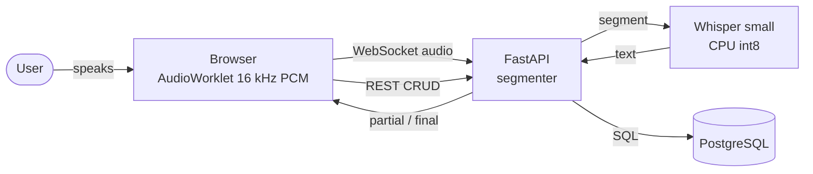

# Real-time Speech-to-Text (Hindi · English · Hinglish)

**Live demo:** https://kasinadhsarma-speech-to-text.hf.space

Web app that transcribes speech **live** from the microphone, including sentences that mix Hindi
and English. Each transcript is stored in PostgreSQL, and a dashboard provides full CRUD and search.

| | |
|---|---|
| **Speech-to-text** | Open-source [Whisper](https://github.com/openai/whisper) via `faster-whisper`, self-hosted (no third-party API) |
| **Backend** | Python 3.12, FastAPI, WebSockets, SQLAlchemy 2 |
| **Database** | PostgreSQL (Neon in production, Docker Compose locally); SQLite fallback |
| **Frontend** | Vanilla JavaScript + AudioWorklet, no build step |
| **Hosting** | Hugging Face Spaces (HTTPS/WSS) |



## Features
- Live transcription: grey partial text updates about every 1.5 s and firms up when you pause
- Mixed Hindi and English (auto-detect per segment, or force `hi` / `en`)
- Transcripts saved automatically on stop
- Dashboard with **create, read, update, delete** and search
- REST API with Swagger UI at `/docs`; health check reports the active database

## Quick start
```bash
docker compose up --build         # PostgreSQL + app at http://localhost:8000
```
Without Docker (SQLite):
```bash
python3 -m venv .venv && .venv/bin/pip install -r requirements.txt
.venv/bin/uvicorn app.main:app    # first start downloads the Whisper model (~460 MB)
```
Click **Start recording**, speak, then click **Stop & save**.

## Project structure
```
app/
  main.py        FastAPI app: REST CRUD, WebSocket streaming, segmentation
  stt.py         faster-whisper model loading and transcription
  db.py          SQLAlchemy engine, Transcription model, DATABASE_URL handling
static/          index.html, style.css, app.js (recorder + dashboard)
hf_entry.py      Hugging Face Spaces entry point (Gradio host)
tests/           test_api.py (CRUD), stream_demo.py (real-time streaming client)
docs/            Markdown documentation + LaTeX/PDF
```

## Configuration
See [`.env.example`](.env.example) and [docs/TECH_STACK.md](docs/TECH_STACK.md#configuration-environment-variables).
Main settings: `DATABASE_URL`, `WHISPER_MODEL`, `WHISPER_COMPUTE`, `WHISPER_THREADS`.

## Tests
```bash
.venv/bin/pip install -r requirements-dev.txt
.venv/bin/pytest -q                                   # CRUD API
.venv/bin/python tests/stream_demo.py speech.pcm auto # live streaming (server on :8000)
```

## Documentation
| Document | Contents |
|---|---|
| [Architecture](docs/ARCHITECTURE.md) | Mermaid diagrams: context, components, sequence, state machine, ER, deployment; design trade-offs |
| [API reference](docs/API.md) | REST endpoints, JSON schemas, WebSocket protocol, client example |
| [Database](docs/DATABASE.md) | ER diagram, table definition, DDL, ORM model, queries |
| [Code reference](docs/CODE_REFERENCE.md) | Every module, constant, class, attribute and function: signatures, parameters, returns, key statements; class and call diagrams |
| [Tech stack](docs/TECH_STACK.md) | Libraries with versions and licenses, model, platform APIs, configuration |
| [Deployment](docs/DEPLOYMENT.md) | Hugging Face Spaces, Docker Compose, Render/Railway/Fly.io |
| [PDF documentation](docs/latex/documentation.pdf) | Full LaTeX technical document ([source](docs/latex/documentation.tex)) |

Build the PDF with `cd docs/latex && pdflatex documentation.tex && pdflatex documentation.tex`.
