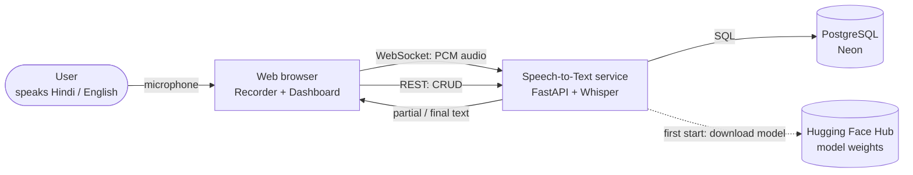
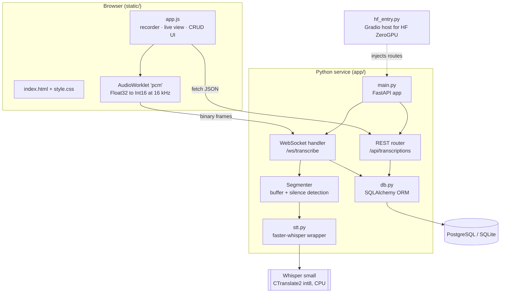
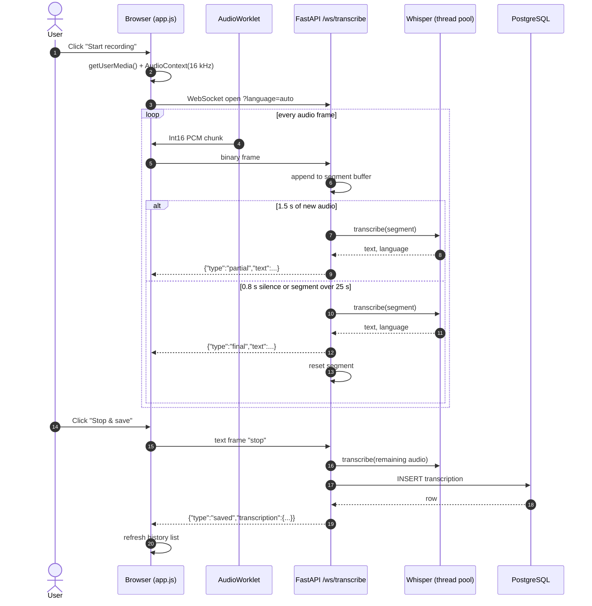
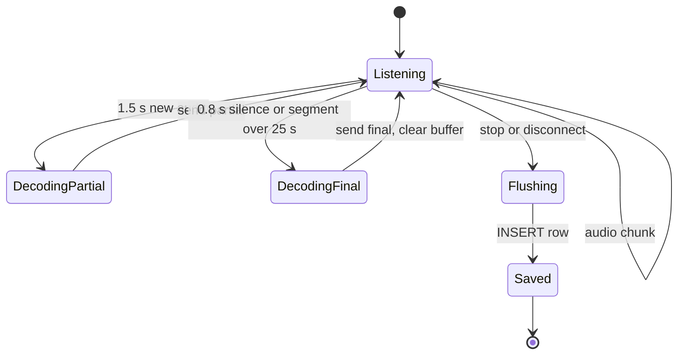
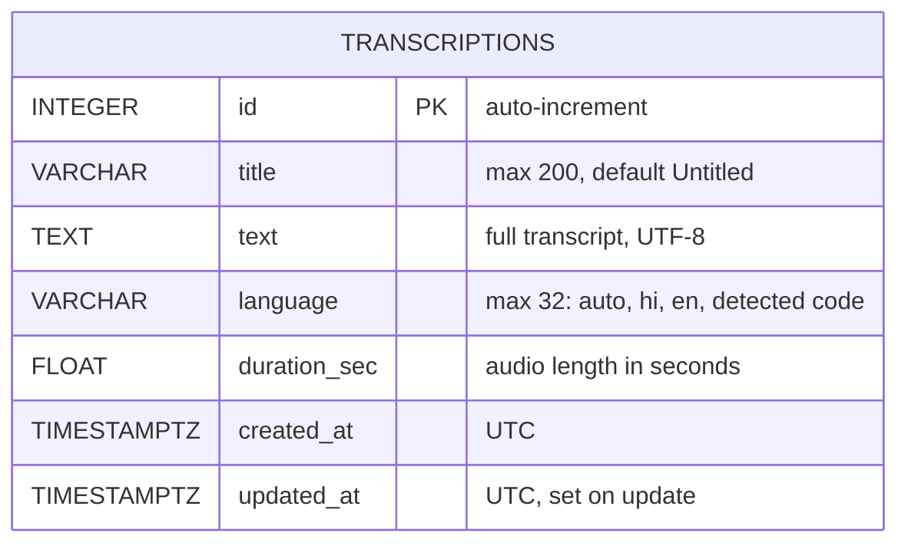
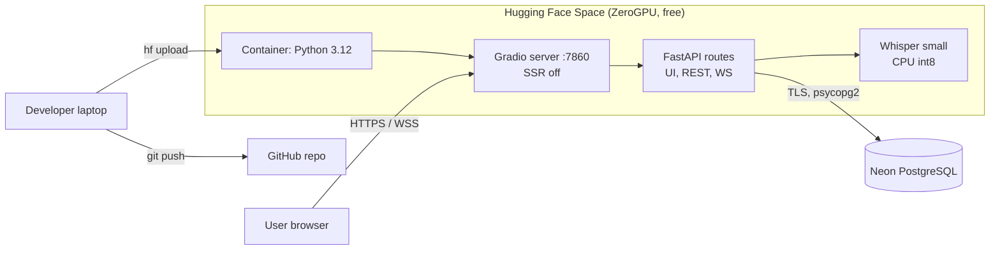

# Architecture

Real-time, multilingual (Hindi · English · Hinglish) speech-to-text service with a CRUD dashboard.

- **Live:** https://kasinadhsarma-speech-to-text.hf.space
- **Related docs:** [API reference](API.md) · [Database schema](DATABASE.md) · [Tech stack](TECH_STACK.md) · [Deployment](DEPLOYMENT.md) · [PDF (LaTeX)](latex/documentation.pdf)

---

## 1. System context

## 2. Components

| Module | Responsibility |
|---|---|
| `static/app.js` | Microphone capture, WebSocket streaming, live transcript rendering, dashboard CRUD |
| `app/main.py` | FastAPI app: REST endpoints, WebSocket endpoint, segmentation loop, static hosting |
| `app/stt.py` | Lazily loads one shared Whisper model; `transcribe(audio, language)` |
| `app/db.py` | Engine/session setup, `Transcription` ORM model, `DATABASE_URL` normalisation |
| `hf_entry.py` | Hugging Face entry point: Gradio owns port 7860, FastAPI routes injected first |

## 3. Real-time transcription sequence

## 4. Segmenter state machine

| Parameter | Value | Where |
|---|---|---|
| Sample rate | 16 000 Hz mono, Int16 | `stt.SAMPLE_RATE`, `app.js` |
| Partial re-decode interval | 1.5 s | `PARTIAL_EVERY_SEC` |
| Silence window / threshold | 0.8 s / RMS 0.012 | `SILENCE_SEC`, `SILENCE_RMS` |
| Max segment length | 25 s | `MAX_SEGMENT_SEC` |
| Decoder | beam 1, VAD filter on, Hinglish `initial_prompt` | `stt.transcribe` |

## 5. Data model

Full DDL, constraints and example rows: [DATABASE.md](DATABASE.md).

## 6. Deployment

Other targets (Docker Compose with Postgres, Render, Railway, Fly.io) are in [DEPLOYMENT.md](DEPLOYMENT.md).

## 7. Multilingual handling

- Whisper is trained on 99 languages, including Hindi, and handles code-switching within one utterance.
- `language=auto` detects the language per segment; the saved row stores the most frequent one.
- A Hinglish `initial_prompt` biases decoding toward mixed Hindi/English output.
- Hindi words come out in Devanagari and English words usually in Latin script. Heavily accented English may be transliterated into Devanagari; larger models (`medium`, `large-v3`) reduce this.

## 8. Design decisions and trade-offs

| Decision | Reason | Trade-off |
|---|---|---|
| Self-hosted Whisper (faster-whisper) | Open source, no API keys, strong Hindi support | 1–3 s CPU latency per decode on free hardware |
| Re-decode the live segment for partials | Whisper is not a streaming model | Repeated compute, bounded by 25 s segments |
| Energy-based silence detection | Simple, no extra dependency | Can mis-segment in noisy rooms (Whisper VAD also on) |
| Raw PCM over WebSocket | No codec on either side, low latency | About 32 KB/s upstream |
| SQLAlchemy + `DATABASE_URL` | Same code on PostgreSQL and SQLite | No migration tool yet (table created on start) |
| Vanilla JS frontend | No build step, small surface | No component framework |

## 9. Known limitations

- No authentication: every visitor shares one history.
- No schema migrations (Alembic) yet; `create_all` runs on startup.
- One shared model instance, so concurrent sessions queue for CPU.
- Microphone access requires HTTPS or `localhost`.
