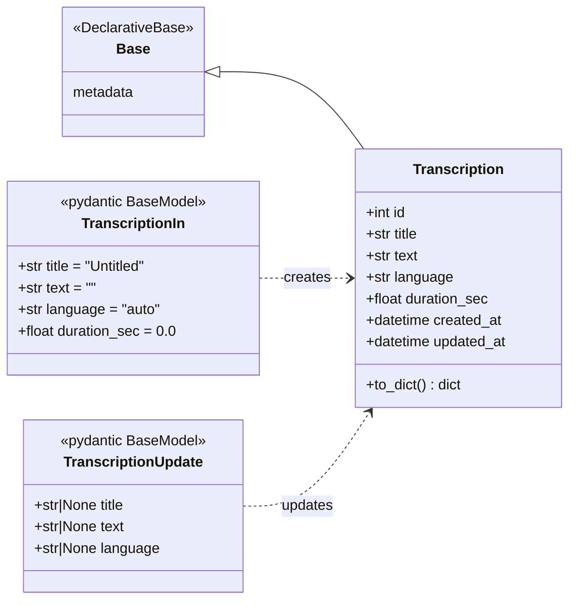
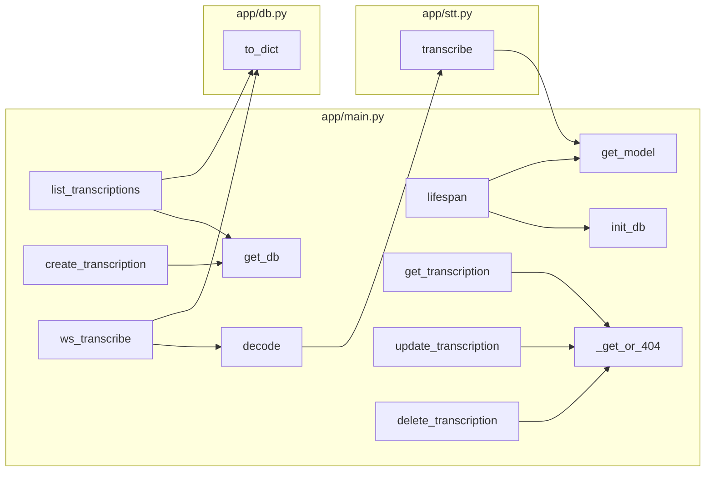

# Code Reference

Every module, constant, class, attribute and function in the project, with signatures, parameters,
return values, side effects and the statements that matter. Source docstrings match this document.





---

## `app/db.py` — database layer

### Module attributes

| Name | Type | Value / source | Purpose |
|---|---|---|---|
| `DATABASE_URL` | `str` | `$DATABASE_URL`, else `sqlite:///./transcriptions.db` | Normalised SQLAlchemy URL |
| `connect_args` | `dict` | `{"check_same_thread": False}` for SQLite, else `{}` | Lets SQLite connections cross threads |
| `engine` | `sqlalchemy.Engine` | `create_engine(DATABASE_URL, pool_pre_ping=True)` | Connection pool |
| `SessionLocal` | `sessionmaker` | `bind=engine, expire_on_commit=False` | Session factory; objects stay readable after commit |

**URL normalisation statements** (run once at import):
1. `(os.getenv("DATABASE_URL") or default).strip().strip("'\"")` — empty values fall back to SQLite; whitespace and quotes are removed.
2. `postgres://…` and `postgresql://…` → `postgresql+psycopg2://…` — selects the installed psycopg2 driver.
3. `&channel_binding=require` is removed — Neon adds it; `sslmode=require` still enforces TLS.

### `utcnow() -> datetime`
Returns `datetime.now(timezone.utc)`. Used as the column default and `onupdate` for timestamps.

### `class Base(DeclarativeBase)`
Declarative base. `Base.metadata` holds the table definitions used by `init_db()`.

### `class Transcription(Base)`
ORM model for table `transcriptions`.

| Attribute | Python type | Column | Default |
|---|---|---|---|
| `__tablename__` | `str` | — | `"transcriptions"` |
| `id` | `int` | `Integer`, primary key, autoincrement | sequence |
| `title` | `str` | `String(200)` | `"Untitled"` |
| `text` | `str` | `Text` | `""` |
| `language` | `str` | `String(32)` | `"auto"` |
| `duration_sec` | `float` | `Float` | `0.0` |
| `created_at` | `datetime` | `DateTime(timezone=True)` | `utcnow()` |
| `updated_at` | `datetime` | `DateTime(timezone=True)` | `utcnow()`, `onupdate=utcnow` |

#### `Transcription.to_dict() -> dict`
Serialises the row for JSON responses: all columns, `duration_sec` rounded to 2 decimals, timestamps as ISO 8601 strings (or `None`).

### `init_db() -> None`
`Base.metadata.create_all(engine)` — creates missing tables; idempotent. Called at startup.

---

## `app/stt.py` — speech recognition

### Module attributes

| Name | Type | Value / source | Purpose |
|---|---|---|---|
| `SAMPLE_RATE` | `int` | `16000` | Sample rate Whisper expects |
| `MODEL_SIZE` | `str` | `$WHISPER_MODEL`, default `"small"` | Whisper model variant |
| `HINGLISH_PROMPT` | `str` | `$WHISPER_PROMPT`, default Hinglish sentence | Decoder `initial_prompt` biasing toward mixed Hindi/English |
| `_model` | `WhisperModel \| None` | `None` until first use | Shared model instance |
| `_lock` | `threading.Lock` | — | Ensures the model loads once |

### `get_model() -> WhisperModel`
Returns the shared model, creating it under `_lock` on first call:

```python
WhisperModel(MODEL_SIZE,
             device=$WHISPER_DEVICE or "cpu",
             compute_type=$WHISPER_COMPUTE or "int8",
             cpu_threads=int($WHISPER_THREADS or 4))
```
**Side effect:** first call downloads weights from the Hugging Face Hub (~460 MB for `small`) unless cached.

### `transcribe(audio, language=None) -> tuple[str, str]`

| Parameter | Type | Description |
|---|---|---|
| `audio` | `np.ndarray` (float32) | Mono 16 kHz samples in [-1, 1] |
| `language` | `str \| None` | Whisper code (`"hi"`, `"en"`, …); `None`, `""` or `"auto"` = detect |

**Returns** `(text, language)` — transcript (may be empty) and detected/forced language code.

**Statements:**
1. If `audio.size < SAMPLE_RATE * 0.3` (under 0.3 s): return `("", language or "auto")` without decoding.
2. Call `model.transcribe(audio, language=…, task="transcribe", beam_size=1, vad_filter=True, condition_on_previous_text=False, initial_prompt=HINGLISH_PROMPT)`.
3. Join the stripped text of each returned segment with spaces.

| Decoder option | Value | Why |
|---|---|---|
| `beam_size` | 1 | Greedy decoding, lowest latency |
| `vad_filter` | `True` | Silero VAD drops non-speech, reducing hallucinations |
| `condition_on_previous_text` | `False` | Each re-decode is independent; avoids repetition loops |

---

## `app/main.py` — FastAPI application

### Module attributes

| Name | Type | Value | Purpose |
|---|---|---|---|
| `STATIC` | `Path` | `<repo>/static` | Frontend files |
| `PARTIAL_EVERY_SEC` | `float` | `1.5` | Seconds of new audio between partial decodes |
| `SILENCE_SEC` | `float` | `0.8` | Trailing window checked for silence |
| `SILENCE_RMS` | `float` | `0.012` | RMS energy below which the window is silent |
| `MAX_SEGMENT_SEC` | `float` | `25.0` | Segment length that forces a final decode |
| `app` | `FastAPI` | `FastAPI(title="Speech to Text", lifespan=lifespan)` | Application instance |

### `lifespan(_: FastAPI)` *(async context manager)*
Startup: `init_db()`; then, unless `PRELOAD_MODEL=0`, loads the model with `await asyncio.to_thread(stt.get_model)`. Nothing on shutdown.

### `get_db() -> Iterator[Session]`
Dependency: yields `SessionLocal()` and closes it in `finally`.

### `class TranscriptionIn(BaseModel)`
| Attribute | Type | Default | Validation |
|---|---|---|---|
| `title` | `str` | `"Untitled"` | `max_length=200` |
| `text` | `str` | `""` | |
| `language` | `str` | `"auto"` | |
| `duration_sec` | `float` | `0.0` | |

### `class TranscriptionUpdate(BaseModel)`
| Attribute | Type | Default | Validation |
|---|---|---|---|
| `title` | `str \| None` | `None` | `max_length=200` |
| `text` | `str \| None` | `None` | |
| `language` | `str \| None` | `None` | |

### Route handlers

| Function | Route | Parameters | Returns | Raises |
|---|---|---|---|---|
| `health()` | `GET /api/health` | — | `{"status","model","database"}`; `database` = `engine.dialect.name` | — |
| `list_transcriptions(q, limit, offset, db)` | `GET /api/transcriptions` | `q: str\|None`; `limit: int` 1–200 (50); `offset: int` ≥0 (0) | `list[dict]` | 422 on bad params |
| `create_transcription(body, db)` | `POST /api/transcriptions` | `body: TranscriptionIn` | `dict`, status 201 | 422 |
| `get_transcription(tid, db)` | `GET /api/transcriptions/{tid}` | `tid: int` | `dict` | 404 |
| `update_transcription(tid, body, db)` | `PUT /api/transcriptions/{tid}` | `tid: int`, `body: TranscriptionUpdate` | `dict` | 404, 422 |
| `delete_transcription(tid, db)` | `DELETE /api/transcriptions/{tid}` | `tid: int` | `None`, status 204 | 404 |
| `index()` | `GET /` | — | `FileResponse(static/index.html)` | — |

**Key statements:**
- `list_transcriptions`: `select(Transcription).order_by(created_at.desc(), id.desc())`; when `q` is set, adds `where(or_(text.ilike(f"%{q}%"), title.ilike(f"%{q}%")))`; then `.limit(limit).offset(offset)`.
- `create_transcription`: `Transcription(**body.model_dump())`, `db.add`, `db.commit`.
- `update_transcription`: loops over `body.model_dump(exclude_unset=True)` and `setattr`s only non-`None` values, then commits (`updated_at` refreshes via `onupdate`).

### `_get_or_404(db, tid) -> Transcription`
`db.get(Transcription, tid)`; raises `HTTPException(404, "Transcription not found")` if missing.

### `ws_transcribe(ws, language="auto")` — `WS /ws/transcribe`

| Parameter | Type | Description |
|---|---|---|
| `ws` | `WebSocket` | Client connection |
| `language` | `str` | Query parameter: `auto`, `hi`, `en`, … |

**Local state:**

| Variable | Type | Meaning |
|---|---|---|
| `sr` | `int` | `stt.SAMPLE_RATE` |
| `segment` | `np.ndarray` float32 | Audio of the current open segment |
| `since_decode` | `int` | Samples received since the last decode |
| `finals` | `list[str]` | Final text of each closed segment |
| `langs` | `list[str]` | Detected language of each closed segment |
| `total_samples` | `int` | All samples received (for `duration_sec`) |

**Nested `decode(final: bool)`** *(async)*: copies `segment`, resets `since_decode`, runs `stt.transcribe` via `asyncio.to_thread`, sends `{"type": "final"|"partial", "text", "language"}` if text is non-empty. When `final`, appends to `finals`/`langs` and clears `segment`.

**Main loop statements:**
1. `msg = await ws.receive()`; break on `websocket.disconnect` or text `"stop"`; ignore other text frames.
2. Convert bytes: `np.frombuffer(data, np.int16).astype(np.float32) / 32768.0`; append to `segment`; add to counters.
3. `silent = segment.size > sr*1.0 and len(tail) >= SILENCE_SEC*sr and rms(tail) < SILENCE_RMS`, where `tail` is the last `SILENCE_SEC` of audio.
4. If `silent` or `segment.size > MAX_SEGMENT_SEC*sr` → `decode(final=True)`; elif `since_decode >= PARTIAL_EVERY_SEC*sr` → `decode(final=False)`.

**After the loop:** decode any remaining audio as final; join `finals`; if non-empty, insert a `Transcription` with `title = text[:60] + "…"` (when longer), the most frequent language (`max(set(langs), key=langs.count)`), and `duration_sec = total_samples / sr`; send `{"type":"saved","transcription":…}` (or `null`), then close.
**Errors:** `WebSocketDisconnect` ends silently; any other exception is sent as `{"type":"error","message":…}`.

### Static mount
`app.mount("/static", StaticFiles(directory=STATIC))` serves `app.js` and `style.css`.

---

## `hf_entry.py` — Hugging Face Spaces entry point

| Name | Kind | Purpose |
|---|---|---|
| `_default_unraisable` | attribute | Original `sys.unraisablehook` |
| `_quiet_unraisable(u)` | function | Ignores `ValueError("Invalid file descriptor…")` from discarded event loops; forwards everything else |
| `gpu` | decorator | `spaces.GPU` on Hugging Face; no-op fallback locally |
| `_placeholder(x: str) -> str` | function | Identity function decorated with `@gpu` to satisfy ZeroGPU's startup check |
| `demo` | `gr.Blocks` | Hidden Gradio app wiring `_placeholder` to an invisible textbox |
| `stt_app` | `FastAPI` | `app.main.app`, whose routes are injected |

**`__main__` statements:** `init_db()`; start `stt.get_model` in a daemon thread; `demo.launch(server_name="0.0.0.0", server_port=$PORT or 7860, ssr_mode=False, app_kwargs={"routes": list(stt_app.routes)})`. Passing the routes to Gradio's FastAPI constructor puts them ahead of Gradio's own, so `/`, `/api/*`, `/ws/*` and `/static/*` reach this app.

---

## `static/app.js` — frontend

### Constants and state

| Name | Kind | Purpose |
|---|---|---|
| `$` | function | `document.querySelector` shorthand |
| `api` | constant | `"/api/transcriptions"` |
| `esc(s)` | function | Escapes `& < > "` before inserting text into HTML |
| `editing` | variable | Row being edited, or `null` when creating |
| `t` | variable | Debounce timer for search |
| `workletSrc` | constant | Source of the `pcm` AudioWorklet processor |
| `ws` | variable | WebSocket to `/ws/transcribe` |
| `ctx` | variable | `AudioContext` at 16 kHz |
| `stream` | variable | Microphone `MediaStream` |
| `node` | variable | `AudioWorkletNode` producing PCM |
| `recording` | variable | `true` while capturing |
| `finals` | variable | Final segments received this session |
| `setStatus(s)` | function | Sets the status label text |

### Functions

| Function | Description |
|---|---|
| `load()` *(async)* | `GET /api/transcriptions?q=…`; renders each row (title, text, date, language, duration, Edit/Delete) or an empty-state message |
| `openDialog(row)` | Fills the dialog with `row` (or blanks when `null`) and opens it |
| `renderLive(partial="")` | Shows final segments followed by the grey partial text |
| `start()` *(async)* | `getUserMedia` → open `ws(s)://host/ws/transcribe?language=…` → wait for open → create `AudioContext({sampleRate:16000})`, load the worklet from a Blob URL, connect mic → worklet, forward each PCM buffer with `ws.send`; updates button and status |
| `stop()` | Resets the button, stops mic tracks, sends `"stop"` |
| `cleanup()` | Stops tracks, disconnects the worklet node, closes the `AudioContext` |

### Event handlers

| Element / object | Event | Action |
|---|---|---|
| `#new` | click | `openDialog(null)` |
| `#cancel` | click | Close dialog |
| `#form` | submit | `PUT {api}/{id}` when editing, else `POST {api}`; then `load()` |
| `#list` | click (delegated) | Delete (with `confirm`) or Edit (`GET` row then `openDialog`) |
| `#search` | input | Debounced `load()` after 250 ms |
| `#rec` | click | Toggle `start()` / `stop()` |
| `ws` | message | `partial` → `renderLive(text)`; `final` → push to `finals`; `saved` → status, `load()`, `cleanup()`; `error` → status |
| `ws` | close | Calls `stop()` if still recording |
| `node.port` | message | Sends the Int16 buffer over the WebSocket when open |

### AudioWorklet processor `PCM` (registered as `'pcm'`)
`process(inputs)`: takes channel 0 (128 Float32 samples), clamps to [-1, 1], scales by 32767 into an `Int16Array`, and posts its buffer to the main thread as a transferable. Returns `true` to stay alive.

---

## `tests/`

| File | Function | Description |
|---|---|---|
| `test_api.py` | `test_crud()` | Uses a temporary SQLite DB with `PRELOAD_MODEL=0`; create (Devanagari + English text) → read → search → update → delete → 404 |
| `stream_demo.py` | `main(path, lang="auto", base="ws://localhost:8000")` *(async)* | Streams a raw 16 kHz Int16 PCM file in 100 ms chunks (plus 2 s of silence) in real time, sends `stop`, prints each message. Usage: `python tests/stream_demo.py file.pcm [lang] [ws-base-url]` |
