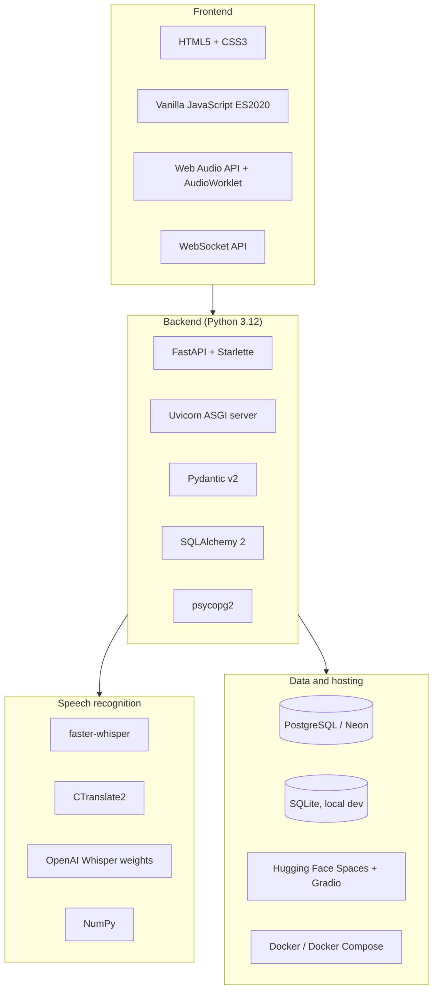

# Tech Stack and Libraries

Every component is open source. Speech recognition runs entirely inside the service, with no third-party speech API.

## Runtime dependencies (`requirements.txt`)

| Library | Version tested | License | Purpose in this project |
|---|---|---|---|
| [FastAPI](https://fastapi.tiangolo.com) | 0.159 | MIT | REST and WebSocket endpoints, OpenAPI/Swagger docs |
| [Starlette](https://www.starlette.io) | 1.9 | BSD-3-Clause | ASGI toolkit under FastAPI; static files, WebSockets |
| [Uvicorn](https://www.uvicorn.org) (`[standard]`) | 0.54 | BSD-3-Clause | ASGI server (uvloop, httptools, websockets) |
| [Pydantic](https://docs.pydantic.dev) | 2.14 | MIT | Request validation (`TranscriptionIn`, `TranscriptionUpdate`) |
| [SQLAlchemy](https://www.sqlalchemy.org) | 2.1 | MIT | ORM, engine, sessions; PostgreSQL and SQLite |
| [psycopg2-binary](https://www.psycopg.org) | 2.9 | LGPL-3.0 | PostgreSQL driver |
| [faster-whisper](https://github.com/SYSTRAN/faster-whisper) | 1.2 | MIT | Whisper inference, built-in Silero VAD filter |
| [CTranslate2](https://github.com/OpenNMT/CTranslate2) | 4.8 | MIT | Optimised int8 CPU inference engine (via faster-whisper) |
| [NumPy](https://numpy.org) | 2.x | BSD-3-Clause | PCM decoding, buffers, RMS silence detection |

## Hosting-only dependencies (Hugging Face Space)

| Library | License | Purpose |
|---|---|---|
| [Gradio](https://www.gradio.app) 6.x | Apache-2.0 | Owns the HTTP server on ZeroGPU Spaces; app routes injected into it |
| [spaces](https://pypi.org/project/spaces/) | Apache-2.0 | ZeroGPU runtime; provides the `@spaces.GPU` decorator |

## Development and test dependencies (`requirements-dev.txt`)

| Library | License | Purpose |
|---|---|---|
| [pytest](https://pytest.org) | MIT | Test runner (`tests/test_api.py`) |
| [HTTPX](https://www.python-httpx.org) | BSD-3-Clause | Used by FastAPI's `TestClient` |
| [websockets](https://websockets.readthedocs.io) | BSD-3-Clause | Streaming client in `tests/stream_demo.py` |

## Model

| Item | Value |
|---|---|
| Model | OpenAI Whisper **small** (244 M parameters), CTranslate2 conversion `Systran/faster-whisper-small` |
| License | MIT |
| Languages | 99, including Hindi (`hi`) and English (`en`); handles code-switching |
| Precision | int8 on CPU (`WHISPER_COMPUTE`) |
| Size | ~460 MB download, ~1 GB RAM at runtime |
| Alternatives | `tiny`, `base` (faster, less accurate); `medium`, `large-v3` (better Hinglish, slower) |

## Frontend platform APIs (no libraries, no build step)

| API | Use |
|---|---|
| `navigator.mediaDevices.getUserMedia` | Microphone capture with echo cancellation and noise suppression |
| `AudioContext({sampleRate: 16000})` | Browser-side resampling to 16 kHz |
| `AudioWorklet` | Converts Float32 samples to Int16 PCM off the main thread |
| `WebSocket` | Binary audio upstream, JSON results downstream |
| `fetch` | Dashboard CRUD calls |
| `<dialog>` | Create/edit modal |

## Infrastructure

| Component | Choice | Notes |
|---|---|---|
| Database | PostgreSQL on [Neon](https://neon.tech) (free tier) | Serverless; `sslmode=require` |
| Local database | SQLite | Zero setup when `DATABASE_URL` is unset |
| App hosting | [Hugging Face Spaces](https://huggingface.co/spaces) (ZeroGPU, free) | HTTPS and WSS included |
| Containers | Docker, Docker Compose (`postgres:16`) | Local full stack, or any container host |
| Source control | Git, GitHub | https://github.com/kasinadhsarma/procucev-speech-to-text |

## Configuration (environment variables)

| Variable | Default | Description |
|---|---|---|
| `DATABASE_URL` | `sqlite:///./transcriptions.db` | SQLAlchemy URL; `postgres://` and `postgresql://` accepted |
| `WHISPER_MODEL` | `small` | `tiny`, `base`, `small`, `medium`, `large-v3` |
| `WHISPER_DEVICE` | `cpu` | `cpu` or `cuda` |
| `WHISPER_COMPUTE` | `int8` | CTranslate2 compute type |
| `WHISPER_THREADS` | `4` | CPU threads for inference |
| `WHISPER_PROMPT` | Hinglish sample sentence | Decoder `initial_prompt` |
| `PRELOAD_MODEL` | `1` | Load the model at startup (`0` to defer) |
| `PORT` | `7860` (Docker/HF), `8000` (Compose) | HTTP port |
